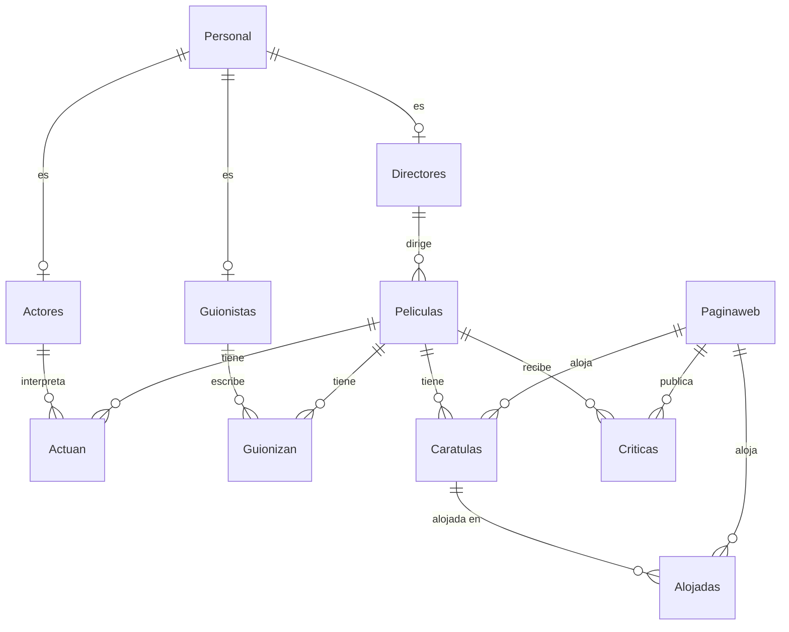

# Modelo de datos

| Tabla | Clave primaria | Descripción |
|---|---|---|
| `Personal` | `nombre` | Personas (con año de nacimiento y fallecimiento); supertipo de actores, directores y guionistas |
| `Actores`, `Directores`, `Guionistas` | `nombre_Personal` | Especializaciones de `Personal` |
| `Peliculas` | `(anio, titulo)` | Título, idioma, duración (min), calificación, género y director |
| `Actuan` | `(actor, anio, titulo)` | Reparto y personaje interpretado |
| `Guionizan` | `(anio, titulo, guionista)` | Guionistas por película |
| `Paginaweb` | `pagina_web` | Sitios que alojan carátulas o publican críticas |
| `Caratulas` | `(nombre, anio, titulo)` | Carátulas de cada película y su tamaño |
| `Alojadas` | `(carátula, anio, web, titulo)` | Fecha en que una carátula se alojó en una web |
| `Criticas` | `(anio, titulo, crítico)` | Puntuación y texto de cada crítica |

Las tablas `auxiliar_*` son de staging: reciben el CSV en bruto y se depuran antes de insertar en las tablas finales.

# Triggers

- **Auditoría** (`auditoria()`): tras cada INSERT, UPDATE o DELETE en las tablas del modelo se registra operación, marca de tiempo, usuario, fila afectada y tabla en `auditoria`.
- **Páginas web** (`check_webpage()`): antes de insertar una carátula o una crítica, da de alta su página web en `Paginaweb` si no existía.
- **Puntuación media** (`puntuacion_media()`): al insertar o modificar una crítica, recalcula la media de la película en la tabla `puntuacion_media`.

# Roles y permisos

| Rol | Permisos |
|---|---|
| `administrador` | Todos los privilegios sobre la base de datos y CRUD sobre todas las tablas |
| `gestor` | `SELECT`, `INSERT`, `UPDATE`, `DELETE` sobre todas las tablas; sin cambios de estructura |
| `critico` | `SELECT` en todo; `INSERT`, `UPDATE`, `DELETE` solo en `Criticas` |
| `cliente` | Solo `SELECT` |
